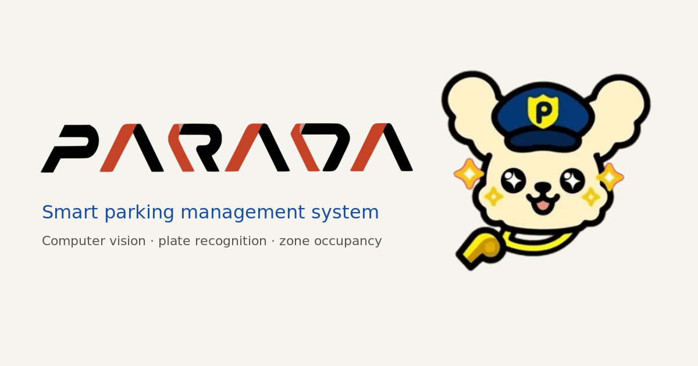

<p align="center">
  
</p>

<h1 align="center">
  
</h1>

<p align="center">
  <b>Project site for PARADA</b>, a smart parking management system:<br>
  zone-gate cameras, CV/OCR plate recognition and zone-based occupancy.
</p>

<p align="center">
  <a href="https://parada.lorenzmalabanan.com"></a>
  <a href="LICENSE"></a>
  <a href="https://github.com/E1yWrites/parada-landing/commits/main"></a>
  
  <br>
  
  
  
  
</p>

<p align="center">
  <a href="https://parada.lorenzmalabanan.com">Live site</a> ·
  <a href="https://parada.lorenzmalabanan.com/technical/">Technical overview</a> ·
  <a href="https://github.com/E1yWrites/parada">App repository</a>
</p>

---

Official site for **PARADA**, a smart parking management system built as a BSIT capstone at Lyceum of the Philippines University — Batangas.

- `/` — **Experience**: an interactive 3D model of the LPU-Batangas campus. Scrolling follows one car through PARADA's pipeline; **Drive in** lets you drive it yourself under the same rules.
- `/technical/` — **Technical**: architecture, features, stack, security and status, written for the capstone panel.

## Stack
- Next.js (static export) + React Three Fiber + drei + GSAP (the tour's timeline, scrubbed by a damped scroll position).
- All copy is plain pre-rendered HTML. The 3D canvas loads after first paint and is optional: with no WebGL or with reduced motion, the page still reads completely.

## Where things live
- `lib/content.ts` holds every fact on the site. Change numbers there only; `lib/content.test.ts` guards them.
- `components/scene/cameraPath.ts` holds the camera stops. Each `data-cam="<key>"` element in the page is one stop; pipeline stops follow the tour car.
- `components/scene/layout.ts` is the campus: zones, gates, the loop driveway, buildings (polygons traced from satellite imagery), walkways, trees, houses and streets. Only Zone A is modelled. Zone counts change only at gate cameras, as in the PARADA backend.
- `components/scene/campusData.ts` is generated from OpenStreetMap by `node scripts/campus-data.mjs` (campus edge and the houses around it). Map data © OpenStreetMap contributors (ODbL).
- Vercel Web Analytics (`@vercel/analytics`, cookieless, same-origin script) is mounted in `app/layout.tsx`; the privacy notice describes it.
- `public/brand/` holds the PARADA logo, mark and mascot from the app repo.
- `app/docs/` and `app/legal/` (terms, privacy, licences) summarise the PARADA repository; `components/AppScreens.tsx` draws the driver app and admin console at step 7 after the app's own design.
- `public/models/props.glb` holds the cars, the motorcycle and the rain tree (Quaternius CC0, jeremy CC BY 3.0, hat_my_guy CC0); see `CREDITS.txt`. Buildings, palms, houses and streets are generated in code (`Buildings.tsx`, `Trees.tsx`, `Campus.tsx`); building names follow the official LPU-B campus map.
- The home page is the final-defense deck: a title slide, four sideways panels (`components/Strip.tsx`), then the defense. Clickers and arrow keys turn one slide (`components/SnapPop.tsx`); thesis facts live in `lib/content.ts` with their sources.

## Run
```bash
npm install
npm run dev     # http://localhost:3000
npm run check   # typecheck + fact and admission-rule tests
npm run build   # static site in out/
```
No environment variables, API keys or database are needed to build or run the site. The build downloads the Google Fonts it uses (`next/font`), so it needs network access.

## Deploy and security
- The site is a static export (`output: 'export'`) deployed on Vercel. There is no server, no database and no secrets.
- `vercel.json` sets the security headers (Content-Security-Policy, `X-Frame-Options`, `nosniff`, `Referrer-Policy`, `Permissions-Policy`, COOP) and redirects `parada-landing.vercel.app` to the canonical domain. The CSP allows inline scripts because a static export cannot carry per-request nonces, and `wasm-unsafe-eval` for the meshopt decoder that unpacks `props.glb`; everything else is same-origin.
- Found a vulnerability? See [SECURITY.md](SECURITY.md).

## Licence and credits
- Code: [MIT](LICENSE).
- The PARADA logo, mark and mascot in `public/brand/` (and the banner and logo above, which are made from them) belong to the PARADA project team, all rights reserved. The MIT licence does not cover them.
- Map data © OpenStreetMap contributors (ODbL). 3D models, fonts and libraries are credited in [`public/models/CREDITS.txt`](public/models/CREDITS.txt) and on the site's [licences page](https://parada.lorenzmalabanan.com/legal/licenses/).
